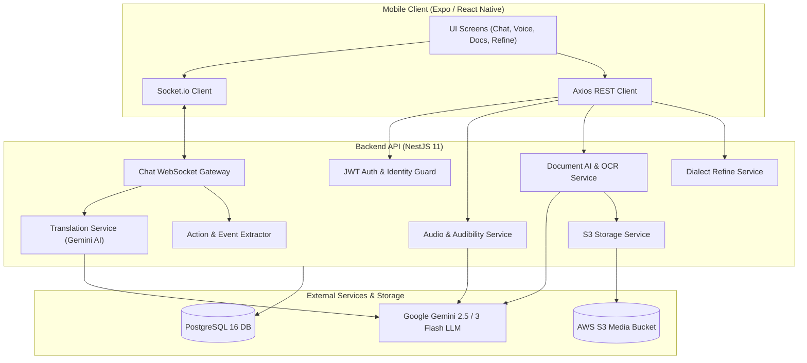

# LinkLanka (The AI Mediator)

[](https://nestjs.com/)
[](https://expo.dev/)
[](https://deepmind.google/technologies/gemini/)
[](https://www.typescriptlang.org/)
[](https://www.postgresql.org/)
[](https://www.docker.com/)

> **LinkLanka** is an AI-powered communication mediator platform engineered to eliminate modern linguistic barriers in Sri Lanka. It bridges informal, code-mixed dialects (**Singlish** and **Tanglish**) and professional multilingual communication by understanding user intent, context, and tone rather than performing literal word-for-word translation.

---

## 📌 Problem Statement

In contemporary Sri Lankan digital communication, millions converse daily using **Singlish** (Sinhala phonetically written in Latin characters) and **Tanglish** (Tamil phonetically written in Latin characters). Standard translation engines (Google Translate, Microsoft Translator, etc.) consistently fail because they attempt literal, word-by-word translations, stripping colloquial nuance, conversational intent, and cultural context.

**LinkLanka acts as an intelligent mediator:**
- **Intent & Tone Preservation:** Instead of literal translation, LinkLanka leverages Google Gemini LLMs to parse underlying intent and conversational tone.
- **Multilingual Bridging:** Seamlessly bridges Singlish, Tanglish, standard Sinhala, Tamil, and English.
- **Formality Register Switching:** Converts informal chat messages into formal corporate memos, emails, and professional submissions.

---

## 🚀 Key Features

### 1. 💬 Real-Time Chat System
- Full-duplex real-time messaging powered by **Socket.io** with JWT-based connection authentication.
- Supports 1-on-1 direct conversations and group discussions.
- Rich messaging: text, audio voice notes, and documents (PDF, Excel, images).
- Message lifecycle management: edit messages, delete for everyone, or hide messages per user.

### 2. 🧠 Intent-Aware Translation Engine
- Multilingual translation across **Singlish**, **Tanglish**, **English**, **Sinhala**, and **Tamil**.
- Conversational context memory preserves multi-turn context and speaker intent.
- Dominance heuristics score mixed scripts to accurately identify the dominant dialect.
- AI confidence scoring and strict JSON schema validation via Zod prevent malformed output.

### 3. 🎙️ Voice Message Processing & Audio Translation
- In-app audio recording with native compression.
- Automated client-side and server-side audibility validation.
- Multimodal Gemini audio processing converts spoken voice notes into clean translated text with optional Text-to-Speech (TTS).

### 4. ✨ "Magic Refine" Dialect Conversion
- On-the-fly register shifting between **Casual** and **Professional/Formal** communication styles.
- Allows students and regional team members to draft casual messages and transform them into polished, executive-ready correspondence.

### 5. 📅 Smart Action & Event Detection
- Automatically parses chat text to detect scheduled meetings, deadlines, and reminders.
- Timezone-aware timestamp extraction locked to `Asia/Colombo` (+05:30).
- 1-tap integration with device calendars via `expo-calendar`.

### 6. 📄 Document AI & OCR
- Upload documents (PDFs, spreadsheets, images) with cloud storage on AWS S3.
- Automatic spreadsheet conversion (Excel `.xlsx`/`.xls` to clean `.csv` for LLM consumption).
- Instant bulleted summaries and point-by-point breakdowns.
- **Document Interrogation:** Interactive Q&A modal allowing users to ask questions directly about uploaded documents.

### 7. 📖 Personal Slang Dictionary (Personal Context)
- User-scoped custom slang and dialect dictionary.
- 50-entry buckets per language: **Singlish**, **Tanglish**, and **English**.
- Injected directly into the LLM system prompt at inference time so user-specific colloquialisms are translated accurately.

---

## 🏗️ Architecture Overview

The project is structured as a clean TypeScript monorepo powered by **Bun**:

```
LinkLanka/
├── apps/
│   ├── api/             # NestJS 11 Backend API & WebSocket Gateway
│   └── mobile/          # Expo 54 / React Native Cross-Platform Mobile Client
├── Docs/                # Project Specifications & SWOT Analysis
├── compose.yaml         # Multi-container Docker Compose configuration
├── render.yaml          # Render Cloud Deployment Blueprint
├── SETUP.md             # Developer environment setup instructions
└── .env.example         # Root environment variables template
```

### High-Level Architecture Flow



---

## 🛠️ Tech Stack

| Domain | Technology | Description |
| :--- | :--- | :--- |
| **Backend Framework** | [NestJS 11](https://nestjs.com/) | Progressive Node.js/Bun framework with TypeScript |
| **Mobile Client** | [React Native 0.81](https://reactnative.dev/) / [Expo 54](https://expo.dev/) | Cross-platform mobile app (Android & iOS) |
| **Language & Runtime** | [TypeScript 5](https://www.typescriptlang.org/) / [Bun](https://bun.sh/) | Type-safe runtime and ultra-fast package manager |
| **AI / LLM** | [Google Gemini](https://deepmind.google/technologies/gemini/) via [LangChain](https://www.langchain.com/) | Gemini 3 Flash Preview & Gemini 2.5 Flash |
| **Real-Time** | [Socket.io 4](https://socket.io/) | Full-duplex WebSocket communication |
| **Database & ORM** | [PostgreSQL 16](https://www.postgresql.org/) / [TypeORM](https://typeorm.io/) | Relational database with automated migrations |
| **Object Storage** | [AWS S3](https://aws.amazon.com/s3/) | Media storage for voice recordings and documents |
| **Authentication** | [Passport JWT](http://www.passportjs.org/) + [Bcrypt](https://github.com/kelektiv/node.bcrypt.js) | Secure token-based auth with salted password hashing |
| **Validation** | [Zod](https://zod.dev/) + [Class-Validator](https://github.com/typestack/class-validator) | Schema verification and runtime data guards |
| **Containerization** | [Docker Compose](https://docs.docker.com/compose/) | Isolated multi-service development environment |

---

## ⚡ Getting Started

### Prerequisites

- [Bun](https://bun.sh/) (v1.3+)
- [Docker](https://www.docker.com/) & Docker Compose
- [Node.js](https://nodejs.org/) (v20+ recommended for Expo tooling)
- [Android Studio](https://developer.android.com/studio) (for Android emulator) or physical device with Expo Go

### 1. Clone & Environment Setup

```bash
git clone https://github.com/MadhukaLakmal/LinkLanka.git
cd LinkLanka

# Create backend and mobile environment files
cp .env.example .env
cp apps/mobile/.env.example apps/mobile/.env
```

Configure `.env` with your credentials:
```env
DB_PASSWORD=your_secure_password
JWT_SECRET=your_jwt_secret_key
GEMINI_API_KEY=your_google_gemini_api_key

# AWS S3 Media Configuration
AWS_S3_BUCKET=your_s3_bucket
AWS_S3_REGION=ap-south-1
AWS_S3_PREFIX=linklanka/
AWS_ACCESS_KEY_ID=your_aws_access_key
AWS_SECRET_ACCESS_KEY=your_aws_secret_key
```

### 2. Run with Docker Compose (Recommended for Backend)

Start PostgreSQL and the NestJS API with hot reload:

```bash
docker compose up --build -d
```

Check service status:
```bash
docker compose ps
docker compose logs -f api
```

### 3. Install Dependencies Locally

```bash
# Backend dependencies
cd apps/api && bun install

# Mobile dependencies
cd ../mobile && bun install
```

### 4. Run Mobile App

```bash
cd apps/mobile

# Run on Android
bun run android

# Or run on iOS (macOS only)
bun run ios

# Or start interactive Expo CLI
bun run start
```

---

## 🗄️ Database Migrations

For production environments where `DB_SYNCHRONIZE=false`, run the SQL migrations located in `apps/api/scripts/`:

```bash
# Migrate personal dictionary language buckets (Singlish / English / Tanglish)
psql "$DATABASE_URL" -f apps/api/scripts/migrate-personal-context-language-buckets.sql

# Migrate client temporary message IDs
psql "$DATABASE_URL" -f apps/api/scripts/migrate-messages-client-temp-id.sql
```

---

## ☁️ Deployment

- **API Deployment:** Pre-configured for [Render](https://render.com/) via `render.yaml` with continuous deployment, automated builds with Bun, health checks on `/`, and managed environment variables.
- **Database:** Compatible with managed PostgreSQL instances (Neon, Supabase, AWS RDS, Render Postgres).
- **Storage:** AWS S3 bucket with IAM credentials scoped to the `linklanka/` folder.

---

## 👥 Academic & Project Information

- **Course:** SE2030 - Software Engineering
- **Project Title:** LinkLanka (The AI Mediator)
- **Role:** Full-Stack AI-Mediated Communication Monorepo
- **Documentation:** Detailed specifications and SWOT analysis are available in the [`Docs/`](./Docs) directory.

---

## 📄 License

This project is licensed under the [ISC License](./package.json).
